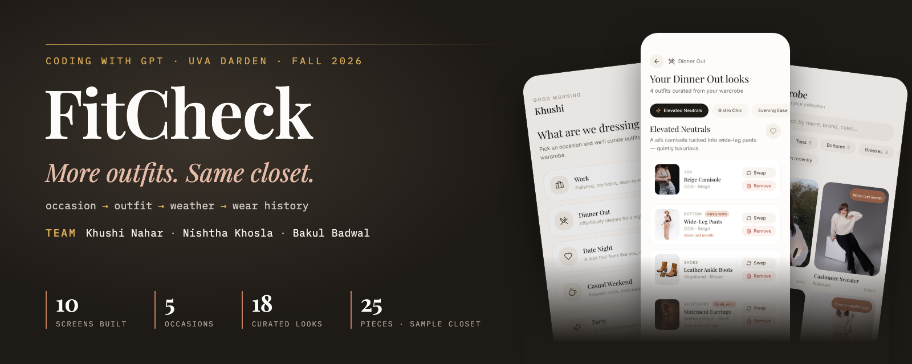
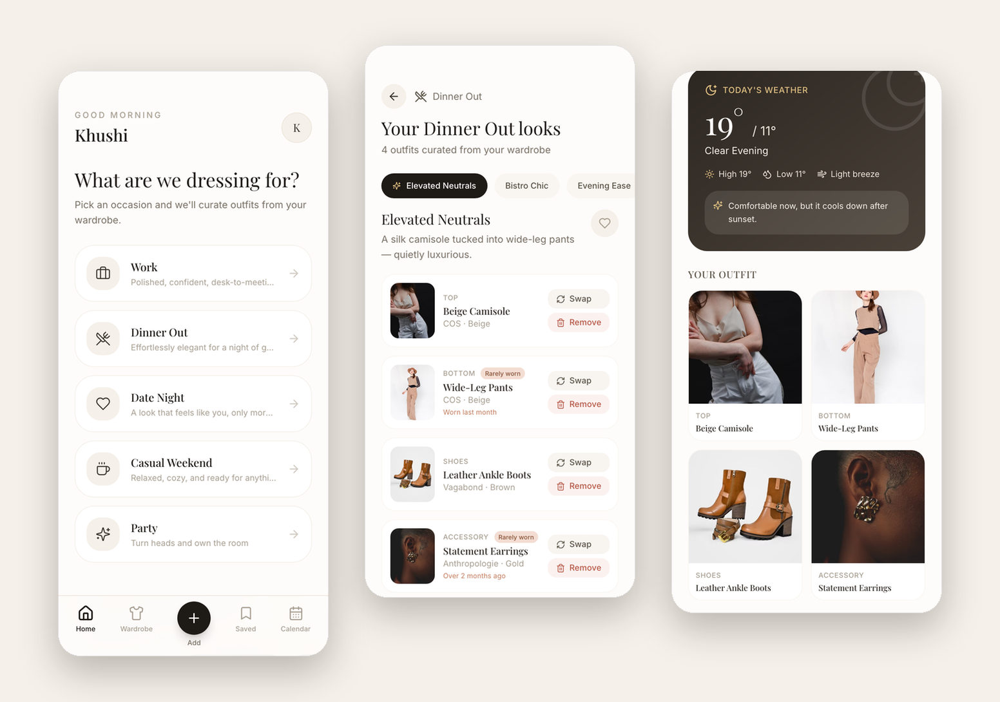
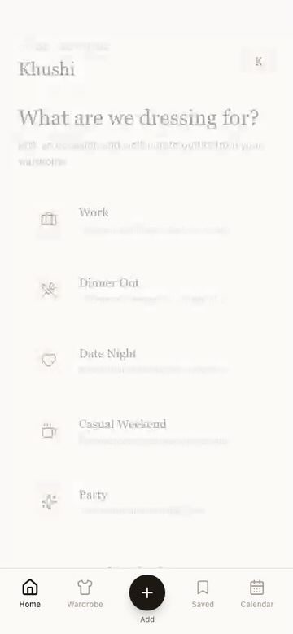
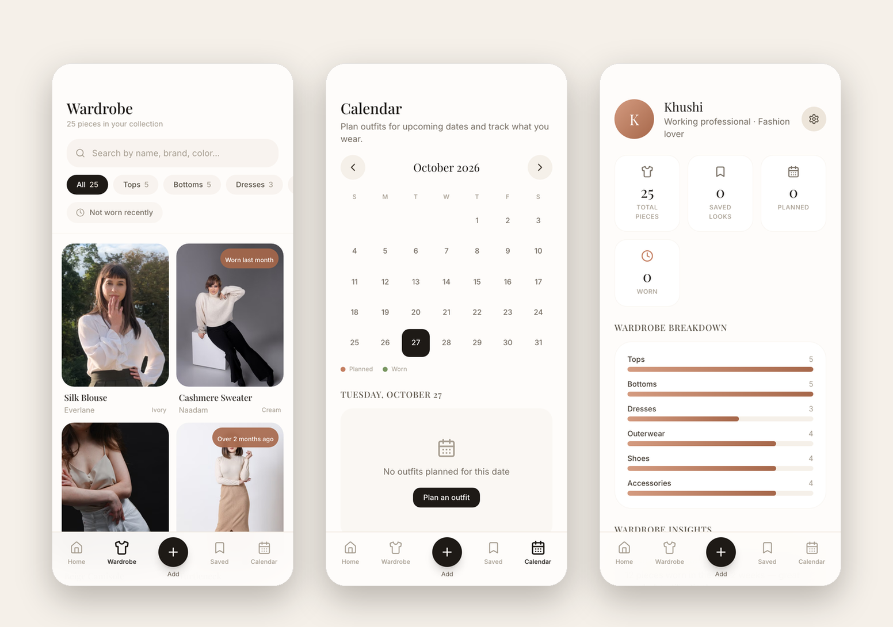

<p align="center">
  <a href="docs/SPEC.md"><b>Product spec</b></a> &nbsp;·&nbsp;
  <a href="docs/IDEAS-BACKLOG.md">Ideas backlog</a> &nbsp;·&nbsp;
  <a href="#try-it-in-30-seconds">Try it</a> &nbsp;·&nbsp;
  <a href="#whats-real-vs-simulated">What's real vs. simulated</a> &nbsp;·&nbsp;
  <a href="#run-it-locally">Run it locally</a>
</p>

<p align="center">
  <a href="package.json"></a>
  <a href="tsconfig.app.json"></a>
  <a href="vite.config.ts"></a>
  <a href="tailwind.config.js"></a>
  <a href="#whats-real-vs-simulated"></a>
</p>

**FitCheck** is a wardrobe app for people who own plenty of clothes but keep wearing the same few outfits. Pick the occasion, get looks built from what you already own, swap pieces, check the weather, and plan the week. The clothes you had forgotten come back to the front.

<p align="center">
  
  <br>
  <sub>The prototype as of 2026-10-27, running on its built-in sample wardrobe. All clothing photos are stock images from Pexels.</sub>
</p>

| Product | Build |
|---|---|
| **User:** a young working professional with a full closet who still feels she has nothing to wear | **Front end:** React 18 + TypeScript + Vite + Tailwind, mobile-first |
| **Job:** get dressed for a specific occasion quickly, using what she already owns | **Data:** browser `localStorage`; ships with a 25-piece sample wardrobe |
| **Promise:** rediscover forgotten clothes instead of buying more | **Backend / AI:** none yet. Recommendations, weather and photo extraction are simulated |
| **Stage:** working clickable prototype, tested with users; now being built into real software | **Origin:** designed and prototyped in Bolt; exported to this repo on 2026-10-27 |

## The problem

Most people wear a small share of what they own. The problem shows up at the moment of getting dressed: there is no time to remember everything in the closet, work out what goes together, or check whether the outfit suits the weather and the day. So people reach for the same few looks and conclude they have nothing to wear.

FitCheck's bet is that **the closet is not the problem; recall is.** Organizing a wardrobe is not enough on its own. The value is making it useful at the moment of decision, for work, dinner, a date, or a weekend.

## Try it in 30 seconds

<table>
  <tr>
    <td width="320" valign="top" align="center">
      
      <br>
      <sub>Recorded from the build on 2026-10-27 (15 seconds, no audio).</sub>
    </td>
    <td valign="top">
      <ol>
        <li>On <b>Home</b>, pick an occasion: Work, Dinner Out, Date Night, Casual Weekend, or Party.</li>
        <li>Flip between the looks for that occasion. Pieces you haven't worn in a while carry a <b>Rarely worn</b> tag.</li>
        <li><b>Swap</b> any piece, <b>Remove</b> it, or <b>Add an item</b> to layer on a jacket or accessory.</li>
        <li>Tap <b>I'd wear this</b> to check the look against the day's weather.</li>
        <li><b>Keep</b> it to put it on today's calendar, or <b>Save</b> it and schedule it for a future date.</li>
        <li>On the <b>Calendar</b>, mark a planned look as worn. That logs the wear date on every piece in it.</li>
        <li>Open <b>Wardrobe</b> to filter by category or by <i>Not worn recently</i>, and tap the avatar for wardrobe insights.</li>
      </ol>
      <p>It all runs in the browser on the built-in sample wardrobe; there is no backend.</p>
    </td>
  </tr>
</table>

## Screens



| Screen | What it does |
|---|---|
| **Home** | Pick the occasion; see today's planned outfit if there is one |
| **Recommendations** | Several looks per occasion; swap, remove, or add pieces; rarely-worn pieces flagged |
| **Confirmation** | Weather check, then keep for today (adds it to today's calendar) or save |
| **Wardrobe** | Every piece, filterable by category or by time since last worn |
| **Add** | Add a piece from a photo; extract pieces from an outfit photo; import past purchases |
| **Saved** | Saved looks, ready to schedule |
| **Calendar** | Plan outfits by date and mark them worn, which logs exact wear dates |
| **Profile** | Totals, wardrobe breakdown by category, and rediscovery insights |

## What's real vs. simulated

The prototype is honest about what it fakes. This is the gap the current build closes.

| Feature | Today | Notes |
|---|---|---|
| Add a piece from a photo | ✅ Real | You type the name, category, color and brand |
| Wardrobe browse and filters | ✅ Real | Category and *Not worn recently* filters |
| Swap, remove, add a layer | ✅ Real | Works on any look |
| Save, calendar, mark worn | ✅ Real | Wear dates are recorded per piece |
| Rarely-worn tags and insights | ✅ Real | Computed from days since last worn (30+ days = rarely worn) |
| Outfit recommendations | 🟡 Simulated | 18 hand-written looks across 5 occasions in `src/data.ts` |
| Weather | 🟡 Simulated | A fixed table per occasion; no live forecast, no °C/°F label |
| Extract pieces from an outfit photo | 🟡 Simulated | Returns preset results; any upload gets Top / Bottoms / Shoes |
| Import past purchases | 🟡 Simulated | Retailer buttons over sample purchase data |
| Sample wardrobe history | 🟡 Simulated | Starter pieces have preset "last worn" values |
| Sync across devices | ⛔ Not built | Everything lives in one browser's `localStorage` |

## What we learned from testing

The team ran a usability walkthrough: a user getting ready for a birthday dinner who wants to avoid her usual outfit.

| Finding | What testers said |
|---|---|
| **Landed** | The visual design and flow, occasion-based suggestions, accessory swapping, *Not worn recently* tags, and the wardrobe insights |
| **Confused** | The difference between keeping an outfit and saving it |
| **Asked for** | Adding layers rather than only swapping, configurable temperature units, a calendar for future plans, and exact wear history |
| **Questioned** | Whether recommendations would be generated or pre-set |

Layers, the calendar, and per-piece wear dates are already in this build. The open items are in the [product spec](docs/SPEC.md).

## Where it goes next

The full list lives in the [ideas backlog](docs/IDEAS-BACKLOG.md), and nothing there is decided yet. The direction in one line: **replace each simulated feature with a real one, starting with the two that make or break the product.**

1. **Getting the closet in.** If setup feels like work, nobody gets to the good part. Real photo-to-piece extraction with a vision model is the first build.
2. **Real recommendations.** Generate looks from the pieces you own, what you've worn recently, the occasion, and the live forecast.
3. **Wear history that fills itself in.** Dated photos of you wearing a piece are past wears, so "last worn" can be accurate from day one.

## Run it locally

Requires Node 18+.

```bash
npm install
npm run dev
```

| Command | What it does |
|---|---|
| `npm run dev` | Start the dev server with hot reload |
| `npm run build` | Production build into `dist/` |
| `npm run preview` | Serve the production build |
| `npm run typecheck` | TypeScript check (passes) |
| `npm run lint` | ESLint (4 unused-import errors carried over from the export) |

To reset the sample wardrobe, clear the site's `localStorage` (keys starting with `fitcheck-`).

<details>
<summary><b>Deploy to GitHub Pages</b> (repo admin, one time; not enabled yet)</summary>
<br>

`.github/workflows/deploy-pages.yml` builds the app and publishes it to GitHub Pages on every push to `main`. The build uses relative paths, so it works at any repo name. To turn it on:

1. Make the repo public (Pages on a private repo needs a paid plan).
2. **Settings → Pages → Build and deployment → Source: GitHub Actions.**
3. **Actions → Deploy to GitHub Pages → Run workflow.** The site appears at `https://<owner>.github.io/<repo>/`.

</details>

## Project structure

```
src/
├── App.tsx            # Screen routing and bottom navigation
├── store.ts           # Wardrobe, saved looks and calendar state (localStorage)
├── types.ts           # ClothingItem, Outfit, SavedOutfit, CalendarEntry, WeatherInfo
├── data.ts            # Sample wardrobe, looks, weather, and the simulated features
└── screens/           # One file per screen
docs/
├── SPEC.md            # Product spec: user, stories, current build, proposed v1
├── IDEAS-BACKLOG.md   # Parked ideas, hard parts, open questions
└── images/            # README banner, screenshots and walkthrough GIF
```

## Known issues

- **Photo storage:** uploaded photos are saved as base64 in `localStorage`, which caps out around 5 MB. A handful of phone photos will fill it and saving will stop working.
- **Weather units:** temperatures are shown without a unit and read as Celsius.
- **Lint:** four unused imports from the Bolt export.

## Credits

**Team:** Khushi Nahar · Nishtha Khosla · Bakul Badwal

Original concept and Bolt prototype by Khushi Nahar.

Built for *Coding with GPT* at UVA Darden, 2026. Clothing photography from [Pexels](https://www.pexels.com).
