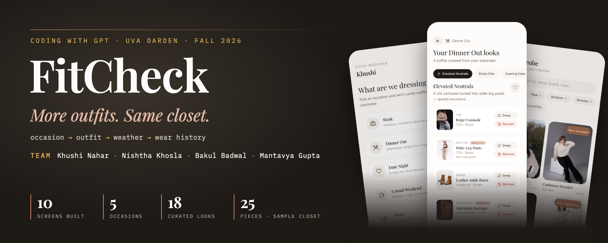
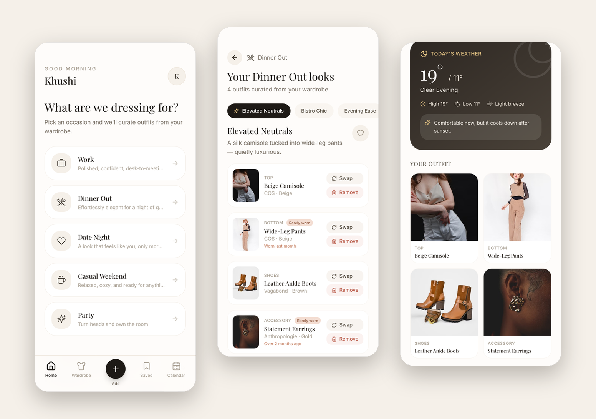
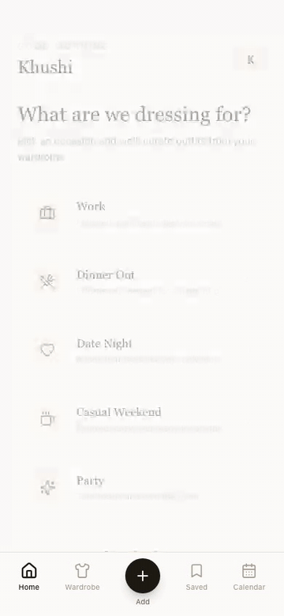
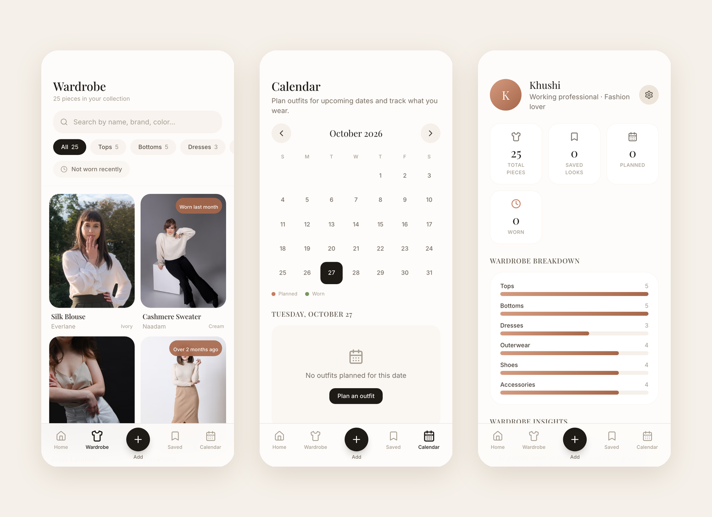

<p align="center">
  <a href="https://khushinahar58-coder.github.io/Fitcheck-/"><b>▶ Try the live app</b></a> &nbsp;·&nbsp;
  <a href="docs/SPEC.md"><b>Product spec</b></a> &nbsp;·&nbsp;
  <a href="docs/IDEAS-BACKLOG.md">Ideas backlog</a> &nbsp;·&nbsp;
  <a href="#try-it-in-30-seconds">Try it</a> &nbsp;·&nbsp;
  <a href="#whats-real-vs-simulated">What's real vs. simulated</a> &nbsp;·&nbsp;
  <a href="#run-it-locally">Run it locally</a>
</p>

<p align="center">
  <a href="package.json"></a>
  <a href="tsconfig.app.json"></a>
  <a href="vite.config.ts"></a>
  <a href="tailwind.config.js"></a>
  <a href="#whats-real-vs-simulated"></a>
</p>

**FitCheck** is a wardrobe app for people who own plenty of clothes but keep wearing the same few outfits. Pick the occasion or just ask, get looks built from what you already own with a reason for each, see them on a 3D figure, check them against the real forecast, and plan the week. The clothes you had forgotten come back to the front.

<p align="center">
  
  <br>
  <sub>The prototype as of 2026-10-27 (the screens have changed since; see the live app). Clothing photos in the first starter closet are stock images from Pexels.</sub>
</p>

| Product | Build |
|---|---|
| **User:** a young working professional with a full closet who still feels she has nothing to wear | **Front end:** React 18 + TypeScript + Vite + Tailwind, mobile-first |
| **Job:** get dressed for a specific occasion quickly, using what she already owns | **Data:** browser `localStorage`; one closet per profile; ships with two starter closets |
| **Promise:** rediscover forgotten clothes instead of buying more | **Backend / AI:** no backend and no AI model. Looks come from a rules engine in the browser; weather is a live forecast; photo extraction is still simulated |
| **Stage:** working clickable prototype, tested with users; now being built into real software | **Origin:** designed and prototyped in Bolt; exported to this repo on 2026-10-27 |

## The problem

Most people wear a small share of what they own. The problem shows up at the moment of getting dressed: there is no time to remember everything in the closet, work out what goes together, or check whether the outfit suits the weather and the day. So people reach for the same few looks and conclude they have nothing to wear.

FitCheck's bet is that **the closet is not the problem; recall is.** Organizing a wardrobe is not enough on its own. The value is making it useful at the moment of decision, for work, dinner, a date, or a weekend.

## Try it in 30 seconds

<table>
  <tr>
    <td width="320" valign="top" align="center">
      
      <br>
      <sub>Recorded from the build on 2026-10-27 (15 seconds, no audio).</sub>
    </td>
    <td valign="top">
      <ol>
        <li>On <b>Home</b>, pick an occasion (Work, Dinner Out, Date Night, Casual Weekend, Party), or tap <b>Ask FitCheck</b> and type "What do I wear to a birthday dinner Friday?"</li>
        <li>Flip between the looks. Each one says why it was picked, and pieces you haven't worn in a while carry a <b>Rarely worn</b> tag.</li>
        <li>Tap <b>On a figure</b> to see the look on a 3D figure you can turn.</li>
        <li><b>Swap</b> any piece, <b>Remove</b> it, or <b>Add an item</b> to layer on a jacket or accessory.</li>
        <li>Tap <b>I'd wear this</b> to check the look against the real forecast.</li>
        <li>Choose <b>Wearing this today</b> to put it on today's calendar, or <b>Save for later</b>.</li>
        <li>On the <b>Calendar</b>, mark a planned look as worn. That logs the wear date on every piece in it, and can be undone.</li>
        <li>Tap the avatar to switch to the second closet, add your own profile, set °F/°C and your city, or shape the figure.</li>
      </ol>
      <p>It all runs in the browser; there is no backend and no account. The demo recording on the left predates these changes.</p>
    </td>
  </tr>
</table>

## Screens



| Screen | What it does |
|---|---|
| **Home** | Today's forecast; pick the occasion or ask; see today's planned outfit if there is one |
| **Recommendations** | Looks generated for the occasion, each with a reason; view on a 3D figure; swap, remove, or add pieces |
| **Ask FitCheck** | Type a request; see what was understood (occasion, day, weather, preferences) and the looks that fit |
| **Confirmation** | The look checked against the forecast, then wear it today, plan it for the day asked about, or save it |
| **Wardrobe** | Every piece, filterable by category or by time since last worn |
| **Add** | Add a piece from a photo, or type a list of what you own and add it all at once |
| **Saved** | Saved looks, ready to schedule |
| **Calendar** | Plan outfits by date, mark them worn (which logs exact wear dates), and undo a wear |
| **Profile** | Switch or add profiles, shape the figure, units and city, wardrobe insights, erase your data |

## What's real vs. simulated

The prototype is honest about what it fakes. This is the gap the current build closes.

| Feature | Today | Notes |
|---|---|---|
| Add a piece from a photo | ✅ Real | You type the name, category, color and brand |
| Type what you own | ✅ Real | A typed or dictated list becomes pieces, each sorted onto a shelf and given a drawn picture |
| Wardrobe browse and filters | ✅ Real | Category and *Not worn recently* filters |
| Outfit recommendations | ✅ Real (rules, not AI) | `src/lib/engine.ts` builds looks from the pieces in the closet, scored for the occasion, forecast, color, recent wear and how long each piece has sat. Same closet and day, same looks |
| Reason for each look | ✅ Real | One line from what drove the score: the rarely-worn piece, the weather, the occasion |
| Weather | ✅ Real | Live forecast from Open-Meteo for the city you choose, in °F or °C; the look is checked against it |
| Ask FitCheck | ✅ Real (pattern matching, not AI) | Reads occasion, day, weather words and a few preferences; says what it understood; never suggests shopping |
| 3D figure | ✅ Real | A simple figure drawn in the browser wearing the look's colors and layers. A sketch, not a photo of you |
| Profiles | ✅ Real | Separate closet, saved looks and calendar per person on a device |
| Swap, remove, add a layer | ✅ Real | Works on any look |
| Save, calendar, mark worn, undo | ✅ Real | Wear dates are recorded per piece |
| Rarely-worn tags and insights | ✅ Real | 30+ days since last worn; a never-worn piece counts from the day it was added |
| Extract pieces from an outfit photo | 🟡 Simulated | Labelled Demo. Returns preset results; needs a vision model |
| Import past purchases | 🟡 Simulated | Labelled Demo. Retailer buttons over sample purchase data; the spec proposes cutting it |
| Starter closet history | 🟡 Simulated | Starter pieces have preset "last worn" values |
| Sync across devices, accounts | ⛔ Not built | Everything lives in one browser's `localStorage` (about 5 MB, which photos fill quickly) |

## What we learned from testing

The team ran a usability walkthrough: a user getting ready for a birthday dinner who wants to avoid her usual outfit.

| Finding | What testers said |
|---|---|
| **Landed** | The visual design and flow, occasion-based suggestions, accessory swapping, *Not worn recently* tags, and the wardrobe insights |
| **Confused** | The difference between keeping an outfit and saving it |
| **Asked for** | Adding layers rather than only swapping, configurable temperature units, a calendar for future plans, and exact wear history |
| **Questioned** | Whether recommendations would be generated or pre-set |

Layers, the calendar, and per-piece wear dates are already in this build. The open items are in the [product spec](docs/SPEC.md).

## Where it goes next

The full list lives in the [ideas backlog](docs/IDEAS-BACKLOG.md), and nothing there is decided yet. The direction in one line: **replace each simulated feature with a real one, starting with the two that make or break the product.**

1. **Getting the closet in.** If setup feels like work, nobody gets to the good part. Typing a list now works; real photo-to-piece extraction with a vision model is the next build, and it needs a decision on which model and who pays for it.
2. **Taste.** The rules engine makes sensible, explainable looks. Whether people would wear them is a question for user testing, not more code.
3. **Wear history that fills itself in.** Dated photos of you wearing a piece are past wears, so "last worn" can be accurate from day one.
4. **Real storage.** A database and image storage, so closets survive a cleared browser and photos stop hitting the 5 MB cap.

## Run it locally

Requires Node 18+.

```bash
npm install
npm run dev
```

| Command | What it does |
|---|---|
| `npm run dev` | Start the dev server with hot reload |
| `npm run build` | Production build into `dist/` |
| `npm run preview` | Serve the production build |
| `npm run typecheck` | TypeScript check |
| `npm run lint` | ESLint |
| `npm test` | Unit and integration tests (Vitest). Also run on every push |
| `npm run test:e2e` | Browser tests (Playwright, needs Chrome). The forecast is stubbed |

To reset a closet or erase everything the app has stored, use **Profile → Your data**.

<details>
<summary><b>Deploy</b> (automatic on every push to <code>main</code>)</summary>
<br>

The live app is at **https://khushinahar58-coder.github.io/Fitcheck-/**. `.github/workflows/deploy-pages.yml` typechecks, builds and publishes it to GitHub Pages on every push to `main`; **Actions → Deploy to GitHub Pages → Run workflow** redeploys on demand. The build uses relative paths, so it keeps working if the repo is renamed (the URL follows the new name).

The live app starts on a starter closet and saves to your browser only; nothing you add leaves your device. The one request it makes is to Open-Meteo, with your city's coordinates, for the forecast.

</details>

## Project structure

```
src/
├── App.tsx            # Profiles, screen routing and bottom navigation
├── store.ts           # One profile's wardrobe, saved looks and calendar (localStorage)
├── types.ts           # ClothingItem, Outfit, SavedOutfit, CalendarEntry, DayWeather
├── data.ts            # The two starter closets, plus the data behind the Demo features
├── lib/               # The logic: outfit engine, Ask, weather, profiles, quick add, drawn pictures
├── three/             # The 3D figure
├── components/        # Icons and the 3D figure card
└── screens/           # One file per screen
tests/                 # Unit and integration tests (npm test)
e2e/                   # Browser tests (npm run test:e2e)
docs/
├── SPEC.md            # Product spec: user, stories, current build, proposed v1
├── IDEAS-BACKLOG.md   # Parked ideas, hard parts, open questions
└── images/            # README banner, screenshots and walkthrough GIF
```

## Known issues

- **Photo storage:** uploaded photos are saved as base64 in `localStorage`, which caps out around 5 MB. A handful of phone photos will fill it; the app shows a warning when that happens. Shrinking photos on upload is open as a pull request.
- **Taste is untested:** the outfit rules are written-down judgment. They pass their own tests; they have not been tried on users yet.
- **Ask FitCheck is pattern matching:** it shows what it understood, and it will miss phrasings nobody planned for.
- **One browser only:** no accounts and no sync. Clearing the browser's site data clears the closet.

## Credits

**Team:** Khushi Nahar · Nishtha Khosla · Bakul Badwal · Mantavya Gupta

Original concept and Bolt prototype by Khushi Nahar.

Built for *Coding with GPT* at UVA Darden, 2026. Clothing photography from [Pexels](https://www.pexels.com).
